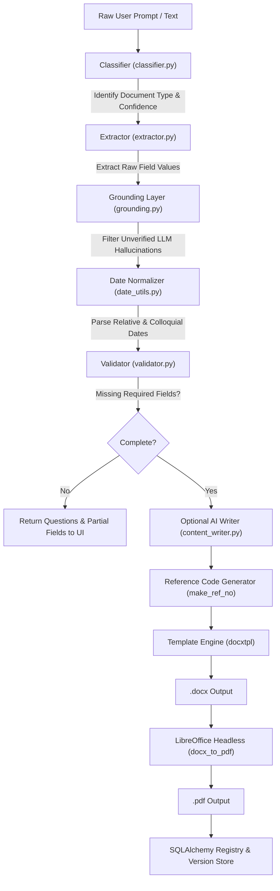

# SmartDocGen (SmartDoc) 📄🤖

[](https://www.python.org/)
[](https://fastapi.tiangolo.com/)
[](https://www.sqlalchemy.org/)
[](https://opensource.org/licenses/MIT)

**SmartDocGen** is an AI-powered administrative document generation and registry system designed for university student chapters, college clubs, and academic bodies (e.g., ACM Student Chapters). It transforms informal, unstructured natural language prompts into institutional, audit-ready **Word (.docx)** and **PDF (.pdf)** documents compliant with institutional formatting, sequential reference numbering, and official signatories.

---

## 📌 Table of Contents

- [Overview & The Problem Solved](#-overview--the-problem-solved)
- [Key Features](#-key-features)
- [Document Generation Pipeline](#-document-generation-pipeline)
- [Supported Document Types](#-supported-document-types)
- [Repository Structure](#-repository-structure)
- [Tech Stack](#-tech-stack)
- [Getting Started](#-getting-started)
  - [Prerequisites](#prerequisites)
  - [Installation](#installation)
  - [Environment Configuration](#environment-configuration)
  - [Database Seeding](#database-seeding)
  - [Running the Server](#running-the-server)
- [API Reference](#-api-reference)
- [Dynamic Templates](#-dynamic-templates)
- [Testing](#-testing)
- [Contributing & License](#-contributing--license)

---

## 💡 Overview & The Problem Solved

College clubs and university student bodies frequently organize workshops, hackathons, and competitions. However, obtaining permissions, disbursing prize money, and filing expense certificates require navigating rigid administrative bureaucracy with dozens of repetitive formal documents.

Students frequently face:
- **Strict Formatting & Signatory Requirements**: Wrong designations, missing faculty coordinators, or improper letter formats cause administrative rejections.
- **Sequential Reference Numbering**: Official letters require specific prefix codes, academic session tracking, and serialized numbering (e.g., `ACM/25-26/ROOM/001`).
- **Repetitive Data Entry**: Retyping event dates, venue names, and faculty details across separate approval notes, room permissions, and bills.
- **AI Hallucinations in Drafting**: Conventional LLMs often fabricate dates, venues, or policies when generating formal letters.

**SmartDocGen** solves this by combining:
1. **Zero-shot natural language understanding** to parse raw event descriptions.
2. An **anti-hallucination grounding layer** that strictly verifies extracted details against the user prompt.
3. **Automated sequential institutional reference numbering**.
4. **Jinja2-powered Word (`.docx`) template rendering** with automated **PDF compilation** via headless LibreOffice.

---

## ✨ Key Features

- **🗣️ Natural Language Request Parsing**: Paste casual event notes (e.g., *"We are planning a 24-hr Hackathon next Friday in the Computer Center for 120 students"*), and SmartDocGen classifies the document type, extracts relevant parameters, and identifies any missing details.
- **🛡️ Anti-Hallucination Grounding Engine**: Cross-checks LLM extraction against raw input text. Any field fabricated or ungrounded by the LLM is flagged and removed before rendering.
- **📅 Smart Date Normalization**: Automatically converts colloquial date expressions (*"tomorrow"*, *"next Tuesday"*, *"15th Oct"*) into ISO dates and flags relative dates for user confirmation.
- **❓ Interactive Clarification**: Identifies missing required fields (e.g., missing venue or coordinator) and builds prompt questions for the user to complete.
- **✍️ AI Formal Section Expansion**: Automatically drafts polished, formal academic paragraphs (e.g., "Event Objectives", "Brief Description") based on factual input notes.
- **🔢 Institutional Reference Registry**: Automatically issues and persists unique reference numbers formatted as `{prefix}/{session_short}/{code}/{seq:03d}` (e.g., `ACM/25-26/ROOM/002`).
- **📄 Dual Format Generation (.docx & .pdf)**: Generates styled Word documents using `docxtpl` and converts them to PDFs with LibreOffice.
- **📑 Dynamic Template Manager**: Upload custom `.docx` templates via API, automatically detect `{{ placeholder }}` variables, validate field bindings, and publish new document types on the fly.
- **👥 Batch Generation**: Bulk-produce personalized documents (such as Prize Money Receipts or Participation Certificates) using shared event data combined with row-by-row recipient records.
- **🗂️ Document Versioning & History**: Full audit trail of document versions, parameters, and generated assets in an SQLite database.

---

## 🔄 Document Generation Pipeline



---

## 📋 Supported Document Types

SmartDocGen comes pre-seeded with official templates:

| Type ID | Document Name | Ref Code | Description | Key Fields |
|:---|:---|:---:|:---|:---|
| `permission_letter` | **Permission (Venue / Room)** | `ROOM` | Official letter requesting hall, lab, or classroom reservation. | `venue`, `event_date`, `start_time`, `end_time`, `tech_name`, `incharge_name` |
| `prize_money_receipt` | **Prize Money Receipt** | `PM` | Disbursement voucher for competition winners. | `student_name`, `roll_no`, `amount`, `bank_name`, `account_no`, `ifsc`, `pan` |
| `submitted_note` | **Submitted Note to Dean** | `NOTE` | Formal approval note seeking executive sanction. | `event_code`, `category`, `objectives`, `target_audience`, `expenses` |
| `bill_summary` | **Bill Summary** | `BS` | Itemized financial accounting summary. | `event_name`, `prize_rows`, `other_rows` |
| `bill_certificate` | **Bill Certificate (Form BC-R)** | `BC` | Mandatory institutional reimbursement certificate. | `approval_note_no`, `purchase_order`, `advance_drawn`, `supplier_gst`, `invoice_no` |
| `invitation_notice` | **Invitation Notice** | `INV` | Campus circular announcing an event to students. | `club_name`, `event_name`, `event_date`, `venue`, `contact_person` |
| `budget_request` | **Budget Request** | `BUD` | Requisition letter detailing expected funds. | `total_amount`, `purpose`, `faculty_coordinator` |

---

## 📂 Repository Structure

```text
smartdocgen/
├── README.md                           # Project documentation
├── doc_types.json                      # Document schema definitions
├── backend/
│   ├── requirements.txt                # Python dependencies
│   ├── debug_case.py                   # Debug utilities
│   ├── test_a1.py                      # Classifier and extractor tests
│   ├── test_llm.py                     # LLM client verification
│   ├── test_pipeline.py                # End-to-end pipeline tests
│   ├── test_render.py                  # Template rendering tests
│   ├── test_validator.py               # Validator unit tests
│   ├── test_writer.py                  # AI content writer tests
│   ├── storage/
│   │   ├── templates/                  # Base Word (.docx) templates
│   │   │   ├── permission_letter.docx
│   │   │   ├── prize_money_receipt.docx
│   │   │   ├── submitted_note.docx
│   │   │   ├── bill_certificate.docx
│   │   │   └── bill_summary.docx
│   │   └── outputs/                    # Generated .docx and .pdf files
│   ├── seed/
│   │   ├── doc_types.json              # Seed data for document schemas
│   │   └── seed.py                     # Database initialization script
│   └── app/
│       ├── __init__.py
│       ├── main.py                     # FastAPI application entrypoint
│       ├── config.py                   # Environment variable loader
│       ├── database.py                 # SQLite engine & SessionLocal
│       ├── models.py                   # SQLAlchemy ORM models (Club, DocType, Document, Version)
│       ├── schemas.py                  # Pydantic request/response models
│       ├── prompts/                    # LLM system prompts
│       │   ├── classify.txt            # Document classifier prompt
│       │   ├── extract.txt             # Entity extraction prompt
│       │   ├── write_section.txt       # Formal prose generation prompt
│       │   └── verify_section.txt      # Fact-checking & alignment prompt
│       ├── routers/
│       │   ├── parse.py                # POST /parse (NL text to structured fields)
│       │   ├── generate.py             # POST /generate & /generate/batch
│       │   ├── ai.py                   # POST /ai/section (custom prose)
│       │   ├── documents.py            # GET /documents & /doc-types
│       │   └── templates.py            # POST /templates/inspect & /templates
│       └── services/
│           ├── classifier.py           # LLM document classification
│           ├── extractor.py            # LLM parameter extraction
│           ├── grounding.py            # Anti-hallucination fact verification
│           ├── date_utils.py           # Date parsing and relative date detection
│           ├── validator.py            # Field validation and question generator
│           ├── content_writer.py       # Formal academic prose writer
│           ├── renderer.py             # DocxTemplate (docxtpl) rendering
│           ├── pdf_converter.py        # Headless LibreOffice PDF converter
│           ├── template_manager.py     # Template placeholder parser and manager
│           ├── pipeline.py             # Integrated parse pipeline orchestrator
│           └── llm_client.py           # OpenAI-compatible LLM client with retries
```

---

## 🛠️ Tech Stack

- **Backend Framework**: [FastAPI](https://fastapi.tiangolo.com/) with asynchronous endpoints and OpenAPI documentation.
- **LLM Integration**: [OpenAI Python SDK](https://github.com/openai/openai-python) compatible with any OpenAI-compatible API (OpenAI GPT-4o, Groq, Ollama, Together AI, vLLM).
- **Template Rendering**: [`docxtpl`](https://docxtpl.readthedocs.io/) (combining `python-docx` and `Jinja2`).
- **PDF Generation**: [LibreOffice](https://www.libreoffice.org/) (`soffice --headless --convert-to pdf`).
- **Database & ORM**: [SQLAlchemy 2.0](https://www.sqlalchemy.org/) with SQLite database (`smartdoc.db`).
- **Data Validation & Parsing**: [Pydantic v2](https://docs.pydantic.dev/), [dateparser](https://dateparser.readthedocs.io/), and [RapidFuzz](https://github.com/rapidfuzz/RapidFuzz).

---

## 🚀 Getting Started

### Prerequisites

1. **Python 3.10+**: Ensure Python is installed on your system.
2. **LibreOffice**: Required for `.docx` to `.pdf` conversion.
   - **macOS**: `brew install --cask libreoffice`
   - **Ubuntu/Debian**: `sudo apt update && sudo apt install -y libreoffice`
   - **Windows**: Download and install from [libreoffice.org](https://www.libreoffice.org/).

### Installation

1. **Clone the repository**:
   ```bash
   git clone https://github.com/kuriyashreyansh/smartdocgen.git
   cd smartdocgen
   ```

2. **Create and activate a virtual environment**:
   ```bash
   python3 -m venv venv
   source venv/bin/activate  # On Windows: venv\Scripts\activate
   ```

3. **Install dependencies**:
   ```bash
   pip install -r backend/requirements.txt
   ```

### Environment Configuration

Create a `.env` file inside the `backend/` directory (or root):

```env
LLM_API_KEY="your-api-key-here"
LLM_BASE_URL="https://api.openai.com/v1"   # Or Groq: https://api.groq.com/openai/v1
LLM_MODEL="gpt-4o-mini"                   # Or llama-3.3-70b-versatile, etc.
```

### Database Seeding

Populate the database with default document schemas and club details:

```bash
python -m backend.seed.seed
```

### Running the Server

Start the FastAPI application with Uvicorn:

```bash
uvicorn app.main:app --reload --app-dir backend
```

Once running:
- **API Base URL**: `http://127.0.0.1:8000`
- **Interactive Swagger Docs**: `http://127.0.0.1:8000/docs`
- **Health Check**: `http://127.0.0.1:8000/health`

---

## 📡 API Reference

### 1. Parse Natural Language (`POST /parse`)
Pass unstructured text to extract document type, parsed fields, and identify missing information.

**Request**:
```json
{
  "text": "We want to book Computer Center lab on 28th October from 2 PM to 5 PM for Web Dev Workshop.",
  "club_id": 1
}
```

**Response**:
```json
{
  "doc_type": "permission_letter",
  "confidence": 0.95,
  "fields": {
    "venue": "Computer Center lab",
    "event_date": "2026-10-28",
    "start_time": "14:00",
    "end_time": "17:00",
    "event_name": "Web Dev Workshop"
  },
  "missing": [
    {
      "key": "tech_name",
      "label": "Tech coordinator name",
      "question": "Who is the student technical coordinator?"
    }
  ],
  "is_complete": false,
  "removed_by_grounding": [],
  "confirm_dates": []
}
```

---

### 2. Generate Document (`POST /generate`)
Generates `.docx` and `.pdf` files, issues a sequential reference number, and saves a version record.

**Request**:
```json
{
  "doc_type": "permission_letter",
  "club_id": 1,
  "fields": {
    "submitted_to": "Head of Computer Engineering",
    "event_name": "Hackathon 2026",
    "venue": "Seminar Hall 1",
    "event_date": "2026-11-15",
    "start_time": "09:00 AM",
    "end_time": "05:00 PM",
    "brief_description": "Annual student coding competition.",
    "objective": "Foster practical software engineering skills.",
    "expected_participants": 100,
    "tech_name": "Alex Smith",
    "tech_designation": "Executive Member",
    "tech_branch": "CSE",
    "tech_mobile": "9876543210",
    "incharge_name": "Dr. R. Sharma",
    "incharge_designation": "Assistant Professor",
    "incharge_branch": "DoCSE"
  },
  "include_ai_section": false
}
```

**Response**:
```json
{
  "document_id": 4,
  "version": 1,
  "ref_no": "ACM/26-27/ROOM/004",
  "docx_url": "/files/ACM_26-27_ROOM_004_v1.docx",
  "pdf_url": "/files/ACM_26-27_ROOM_004_v1.pdf",
  "warnings": []
}
```

---

### 3. Batch Generation (`POST /generate/batch`)
Generates multiple documents from common event metadata and individual recipient rows (e.g. for bulk certificates or prize receipts).

**Request**:
```json
{
  "doc_type": "prize_money_receipt",
  "club_id": 1,
  "common": {
    "event_name": "CodeClash 2026",
    "event_date": "2026-10-25",
    "venue": "Auditorium"
  },
  "rows": [
    {
      "student_name": "John Doe",
      "roll_no": "U22CS001",
      "position": "1st",
      "amount": 5000,
      "account_holder": "John Doe",
      "bank_name": "SBI",
      "bank_branch": "SVNIT Campus",
      "account_no": "12345678901",
      "ifsc": "SBIN0003320",
      "pan": "ABCDE1234F"
    }
  ]
}
```

---

### 4. AI Formal Prose Expansion (`POST /ai/section`)
Drafts academic or administrative sections from unstructured notes.

**Request**:
```json
{
  "section": "Objectives of the Workshop",
  "facts": {
    "topic": "Machine Learning in Healthcare",
    "hands_on": "Deploying models to edge devices",
    "audience": "Pre-final year undergraduates"
  },
  "detail_level": "standard",
  "tone": "formal"
}
```

---

### 5. Document Registry & History
- `GET /documents?club_id=1`: Lists all generated documents with reference numbers, status, and latest file links.
- `GET /documents/{document_id}`: Retrieves complete version history and historical snapshots for a document.
- `GET /doc-types`: Returns all registered document templates and field specifications.

---

## 📑 Dynamic Templates

SmartDocGen supports dynamically adding custom document templates without modifying code:

1. **Create your Word template (`.docx`)** with Jinja2 placeholder tags:
   - User inputs: `{{ event_name }}`, `{{ venue }}`, `{{ event_date }}`
   - Official signatories: `{{ club.signatory_name }}`, `{{ club.signatory_designation }}`
   - Automated reference: `{{ ref_no }}`, `{{ date }}`
   - Tables: ` {{ item.name }} {{ item.cost }} `
2. **Inspect the template**:
   ```bash
   curl -X POST "http://127.0.0.1:8000/templates/inspect" -F "file=@my_template.docx"
   ```
   *The system extracts all detected `{{ placeholder }}` keys.*
3. **Register & publish**: Call `POST /templates` with field types and labels. The new document type is immediately available across all endpoints.

---

## 🧪 Testing

Run test scripts in the `backend/` directory:

```bash
# Test classifier and extractor with local caching
python backend/test_a1.py

# Test LLM client connectivity
python backend/test_llm.py

# Test validation and field rules
python backend/test_validator.py

# Test template rendering
python backend/test_render.py
```

---

## 🤝 Contributing & License

Contributions are welcome! Please open an issue or pull request for suggestions, bug fixes, or new templates.

This project is licensed under the **MIT License**.